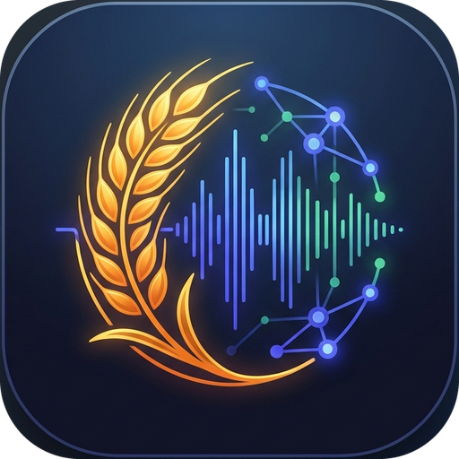

<p align="center">
  
</p>

# BharatLangTech AI (भारतलँगटेक एआय)

A voice question-answering assistant for Maharashtra farmers. A farmer asks about government agricultural schemes in Marathi or the Varhadi (Vidarbha) dialect, by voice or text, and gets a Marathi answer drawn only from official government documents (GRs), with page citations, read aloud.

It is a research prototype, not a production service. The knowledge base currently holds **7 documents (772 chunks)**: PM-KISAN (FAQ and guidelines), PMFBY crop insurance 2025-26, the comprehensive crop insurance top-up, the 2019 Karjmukti loan waiver and its 2022 incentive, and Namo Shetkari Mahasanman Nidhi.

---

## How a question is answered

```
voice ──► speech-to-text ──► dialect normalisation ──► retrieval ──► evidence gate ──► LLM ──► checks ──► answer + citations ──► text-to-speech
text  ───────────────────────────┘
```

| Step | What runs | Code |
|---|---|---|
| Speech-to-text | `indicwhisper-medium-mr` (faster-whisper / CTranslate2) on the desktop GPU; `assemblyai` (cloud) on the AWS deployment | `backend/app/services/asr/` |
| Dialect normalisation | Lexicon-based Varhadi → standard Marathi. The citizen's original words are kept and searched alongside the normalised query | `services/translation/normalization.py`, `dialect_lexicon.py` |
| Retrieval | `intfloat/multilingual-e5-small` embeddings (CPU) + FAISS flat index, plus a district × crop lookup that pulls the exact rate-table row | `services/rag/retrieval.py`, `table_lookup.py` |
| Evidence gate | If the question names a district or crop that no retrieved chunk covers, the system refuses without calling the LLM | `services/rag/evidence_gate.py` |
| LLM answer | `LLM_PROVIDER=ollama` (local `qwen3.5:9b`) or `LLM_PROVIDER=bedrock` (Amazon Bedrock, `qwen.qwen3-32b-v1:0` by default) | `services/llm/provider.py` |
| Checks | Numbers not found in the evidence get a visible warning (`unverified_numbers`). An answer not in Marathi gets one retry, then a warning | `services/rag/numeric_guard.py`, `answer_language.py` |
| Text-to-speech | `edge-tts` (Microsoft's online voices `mr-IN-AarohiNeural` / `mr-IN-ManoharNeural`) | `services/tts/indic_tts.py` |

The corpus is built offline from the GR PDFs. Scanned pages are OCR'd with Surya; table cells are expanded into a grid so each chunk keeps its district, season and column headings (`backend/app/services/rag/corpus/`). PDFs uploaded through the UI are parsed with PyMuPDF and Tesseract.

---

## What is local and what is a cloud service

Be aware of what leaves the machine:

| Service | When it is used | What is sent |
|---|---|---|
| Microsoft edge-tts | Always, for spoken answers | The answer text |
| Amazon Bedrock | Only with `LLM_PROVIDER=bedrock` | The question plus up to 4 retrieved excerpts (~2,400 characters) |
| AssemblyAI | Only with `ASR_ACTIVE_MODEL=assemblyai` and a key set | The recorded audio (deleted after transcription by default) |
| Hugging Face | First run only | Model downloads |

With `LLM_PROVIDER=ollama` and a local ASR engine, everything except text-to-speech runs on your own machine.

---

## Deployments

| | Desktop box (development) | AWS (online demo) |
|---|---|---|
| Machine | Windows, RTX 3060 Ti 8 GB, 32 GB RAM | EC2 m7i-flex.large (2 vCPU, 8 GB), Ubuntu 24.04, Sydney |
| LLM | Ollama `qwen3.5:9b` on the GPU | Bedrock `qwen.qwen3-32b-v1:0` |
| Speech-to-text | `indicwhisper-medium-mr` on the GPU | AssemblyAI (much less accurate for Marathi, see below) |
| Embeddings | CPU | CPU |
| Access | Local network / SSH tunnel | HTTPS with a login (the app itself has no user accounts yet) |

The AWS account has no GPU, so voice questions there use AssemblyAI.

### Local vs AWS, measured end to end (2026-11-14)

The same code ran on both machines (357 tests pass on each). Each item was sent 10 times to each deployment through the public API, from one client on the local network. The set was 12 graded typed questions (8 with figures checked against the GR tables, 4 that must be refused) and 4 recorded voice questions. Runner: `scripts/bench_deployments.py`; scorer: `scripts/bench_score.py`.

| | Desktop (local) | AWS |
|---|---|---|
| Typed questions correct | **120/120 (100%)** | 87/120 (72.5%) |
| Voice questions correct | **40/40 (100%)** | 0/40 (0%) |
| Speech-to-text WER on the 4 clips | **10.6%** | 62.8% |
| Wrong refusals of answerable questions | 0/120 | 12/120 |
| Invented figures (hand-checked) | 1/160 | 0/160 |
| Median time, typed question | 8.8 s | **5.2 s** |
| Median time, voice question | **11.8 s** | 12.5 s |
| First request after a restart | 9.7 s | 6.2 s |
| Network overhead (median) | 0.02 s (LAN) | 0.4 s typed, 1.4 s voice (India → Sydney) |
| What leaves the machine | answer text (for text-to-speech) | question, retrieved excerpts and audio (Bedrock, AssemblyAI), plus the answer text |
| Availability | only while the desktop PC is on | 24/7 |
| Access | local network or SSH tunnel | public HTTPS with a login |
| Cost per 1,000 questions | not measured | not measured |

Both paired differences in accuracy are far outside chance: exact McNemar p ≈ 2e-10 for typed questions and ≈ 2e-12 for voice. On AWS, Bedrock Qwen3-32B retrieved the same pages but left the figure out of 3 of the table lookups every time. AssemblyAI's Marathi transcripts were too poor for any voice answer to contain the asked figure. AWS is faster only for typed questions.

The test set is small: 12 questions and 4 clips from a single speaker. The repeats show consistency, not coverage. Full results: `docs/evaluation.md`.

---

## Measured results

These are real measurements; the details are in [`docs/evaluation.md`](docs/evaluation.md).

**Speech-to-text, full Marathi test sets** (RESPIN mr: 2,170 clips, 160 speakers; FLEURS mr: 1,015 clips; 95% speaker-level bootstrap intervals; RTX 3060 Ti):

| Engine | RESPIN WER | FLEURS WER |
|---|---|---|
| **indicwhisper-medium-mr** | **26.9%** [25.1–28.7] | **22.8%** [21.7–23.9] |
| whisper-small-marathi (steja) | 57.7% | 52.0% |
| whisper large-v3-turbo | 81.6% | 81.3% |
| whisper medium | 90.6% | 89.3% |
| whisper small | 101.6% | 106.3% |

On a 14-clip side-by-side, AssemblyAI scored 86.5% WER against 26.9% for IndicWhisper.

**Retrieval** (698 district × crop rate-table lookups): recall@1 0.971, recall@4 1.000.

**Latency**: about 4.6 s per typed question on the AWS server (Bedrock Qwen3-32B), and 5.8 s round trip from India.

---

## Running it locally

Requirements: Python 3.12, [uv](https://docs.astral.sh/uv/), Node 20+ with [pnpm](https://pnpm.io), ffmpeg, and Tesseract with Marathi (`mar`) data. An NVIDIA GPU is optional but needed for fast local speech-to-text. Full steps: [`docs/installation.md`](docs/installation.md).

```bash
# Backend
uv venv --python 3.12 .venv
uv pip install -r requirements.txt          # CPU-only torch: install torch from https://download.pytorch.org/whl/cpu first
cp .env.example .env                        # then edit; see "Configuration" below

# Local LLM (skip if you use Bedrock)
ollama pull qwen3.5:9b

# Start the API
.venv/bin/uvicorn backend.app.main:app --host 127.0.0.1 --port 8000

# Frontend (dev server proxies /api and /static to :8000)
cd frontend
pnpm install
pnpm dev                                    # http://localhost:5173
```

The scripts in `scripts/*.sh` are the original macOS/Homebrew setup and assume Apple hardware. On Windows, the desktop uses `scripts/start_services.ps1`.

---

## Configuration

All settings live in `.env` (see `.env.example` and `backend/app/core/config.py`). The main ones:

| Setting | Values |
|---|---|
| `LLM_PROVIDER` | `ollama` (default) or `bedrock` |
| `OLLAMA_MODEL` | e.g. `qwen3.5:9b` |
| `BEDROCK_MODEL_ID`, `BEDROCK_REGION` | e.g. `qwen.qwen3-32b-v1:0`, `ap-southeast-2`. Credentials come from the standard AWS chain (instance role, profile or env), never from `.env` |
| `ASR_ACTIVE_MODEL` | `indicwhisper-medium-mr`, `whisper-small-marathi-steja`, `faster-whisper-small`, `assemblyai`, … |
| `WHISPER_DEVICE`, `WHISPER_COMPUTE_TYPE` | `cuda` + `int8_float16` on an NVIDIA GPU, `cpu` + `int8` otherwise |
| `EMBEDDING_DEVICE` | `cpu` recommended (keeps GPU memory for the LLM and ASR) |

`GET /api/health` reports the active LLM provider and model, the ASR engines, the compute device and the index size, for operators. The web interface uses only `services.llm.is_running` from it, to show "service available" or "temporarily unavailable" in plain words.

---

## Web interface

The website is a plain citizen interface in Marathi, Varhadi, Hindi and English, and it shows no technical details: no model, engine or library names, timings, confidence scores or chunk counts. It has four screens:

- **Home:** what the assistant does, how to ask, and example questions.
- **Voice:** record or choose an audio file, then check and correct the transcript before asking.
- **Chat:** answers with the document name and page, and a reminder to check the original.
- **Government documents:** the corpus documents from `manifest.json`, served by `GET /api/documents/sources` with links to the official copies.

The operator screens (document upload, delete and reindex, plus the ASR and retrieval benchmarks) open only at `/#admin`. They are lazy-loaded, so their wording is not in the citizen bundle. Opening them at `/#admin` hides them from citizens but does not secure them: the API endpoints behind them need their own authentication before the site's login is removed.

---

## Tests

```bash
.venv/bin/python -m pytest backend/tests -q -p no:cacheprovider
```

The full suite (357 tests, including the end-to-end API scenarios against live Bedrock) passed on the AWS server on 2026-11-14. The end-to-end tests need the real index in `backend/data/indexes/`.

---

## Repository layout

```
backend/app/
  api/            FastAPI routes: chat, speech, documents, translation, feedback, evaluation, health
  core/           settings (.env), logging
  services/
    asr/          engine registry, faster-whisper, AssemblyAI, long-audio splitting
    translation/  Varhadi normalisation and lexicon, NLLB translation endpoint
    rag/          retrieval, table lookup, evidence gate, numeric guard, answer language, corpus build
    llm/          provider switch, Ollama and Bedrock clients, shared prompt + fallback
    tts/          edge-tts
  evaluation/     ASR benchmark (RESPIN / FLEURS) and retrieval metrics
backend/data/     documents, OCR results, FAISS index, SQLite db
backend/tests/    pytest suite
frontend/src/     React 19 + Vite + TypeScript + Tailwind
docs/             architecture, installation, evaluation
scripts/          setup and service scripts, OCR and scoring tools
```

---

## Credits

Built with [faster-whisper](https://github.com/SYSTRAN/faster-whisper), AI4Bharat's IndicWhisper (Vistaar) Marathi model, [Sentence-Transformers](https://sbert.net) (`intfloat/multilingual-e5-small`), [FAISS](https://github.com/facebookresearch/faiss), [Ollama](https://ollama.com) and [Qwen](https://huggingface.co/Qwen), Amazon Bedrock, [Surya OCR](https://github.com/datalab-to/surya), [Tesseract](https://github.com/tesseract-ocr/tesseract), [PyMuPDF](https://pymupdf.readthedocs.io/), [FastAPI](https://fastapi.tiangolo.com/) and [React](https://react.dev/).

---

## Licence

Licensed under the **Apache License, Version 2.0**: see [`LICENSE`](LICENSE). You may use, modify and redistribute this software, including commercially, provided you:

- keep the copyright notice and include the [`NOTICE`](NOTICE) file with any redistribution or derivative work;
- give credit: *"BharatLangTech AI by Aakash Bhat and contributors"*;
- state any significant changes you made.

The licence covers the source code only. Model weights and online services the software downloads or calls (IndicWhisper, multilingual-e5, Qwen, NLLB-200, Surya, Tesseract data, edge-tts) keep their own licences. NLLB-200 in particular is non-commercial (CC BY-NC 4.0). The government documents in `backend/data/documents/` are public documents and are not covered by this licence.
