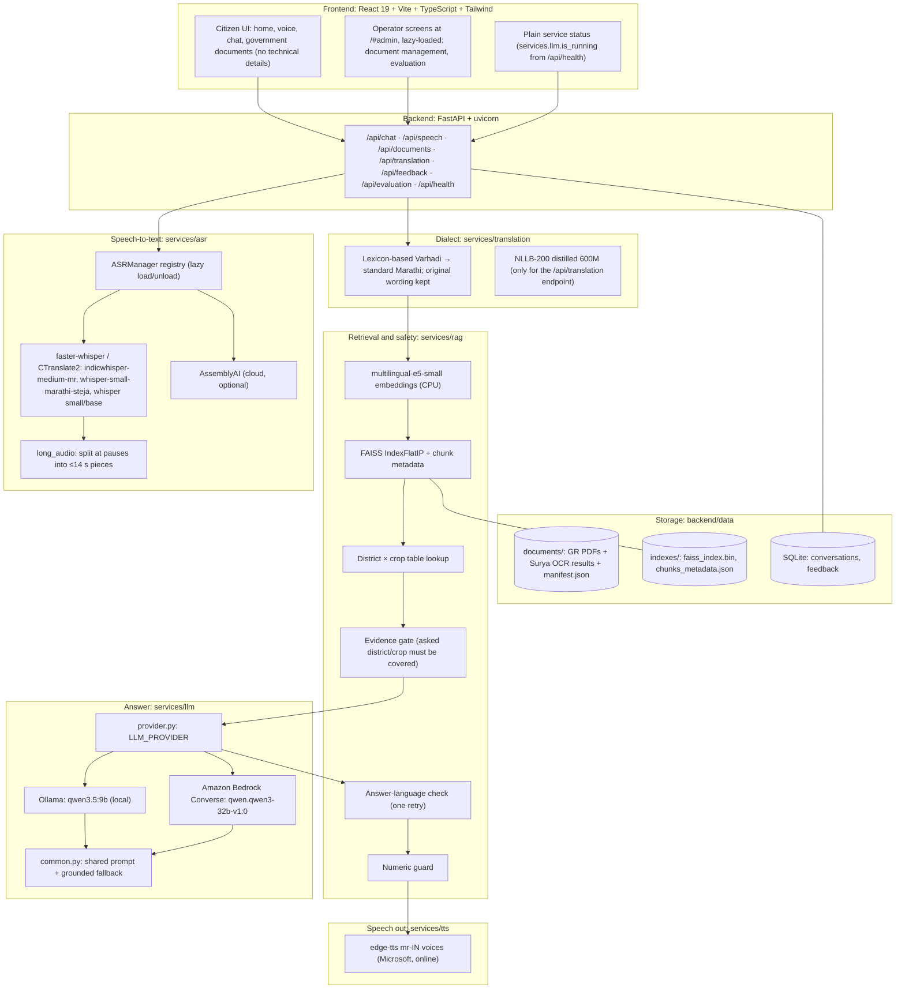

# Architecture

BharatLangTech AI answers questions about Maharashtra agricultural schemes in Marathi and Varhadi, using only official government documents as evidence. It runs in two configurations:
- **Desktop GPU box** (development): all models local except text-to-speech.
- **AWS** (online demo): no GPU, so the LLM is Amazon Bedrock and speech-to-text is AssemblyAI.

The code is the same; `.env` chooses.

## 1. Components

## 2. Request flow (`services/rag/answer_generation.py`)

1. **Speech-to-text** (voice only). `ASRManager` runs the engine named by `ASR_ACTIVE_MODEL`. Long audio is split at pauses, because one 30 s Whisper window holds only ~220 Devanagari characters and longer questions lost their ending. AssemblyAI is registered only when `ASSEMBLYAI_API_KEY` is set.
2. **Dialect step.** `normalization.py` detects Varhadi markers and maps them to standard Marathi with `dialect_lexicon.py`. The citizen's original transcript is never overwritten. Both the normalised and the original wording are searched (`search_multi`).
3. **Retrieval.** e5-small query embedding → FAISS top-k. The district × crop lookup (`table_lookup.py`) puts up to 2 rate-table chunks whose cells match the asked pair first. The lexicon, document scope and table index are cached together per index generation (`evidence_index.py`).
4. **Evidence gate** (`evidence_gate.py`, `entity_lexicon.py`). It reads the district and crop the question asks about. Background mentions don't count; the last-asked entity does. It drops chunks for a different district or crop. If nothing covers the asked pair, it returns a fixed refusal (`abstention_reason="evidence_mismatch"`) and the LLM is not called. Statewide GRs cover any district.
5. **LLM.** `provider.py` returns the Ollama or Bedrock client; both build the same prompt (`common.render_rag_prompt`: question, original wording, up to 4 excerpts of 600 characters, ASCII digits). The Bedrock client drops reasoning/`<think>` blocks. Either client falls back to a grounded, rule-based answer quoting the top excerpt if the service fails.
6. **Answer-language check.** If the answer is not in Marathi, it retries once with an explicit instruction, then warns.
7. **Numeric guard.** Numbers (3+ digits or decimals) in the answer that are not in the evidence or the question get a bilingual warning and are listed in `unverified_numbers`.
8. **Text-to-speech.** edge-tts, Marathi neural voices. The text goes to Microsoft's service.

## 3. Corpus build (`services/rag/corpus/`)

The corpus is driven by `backend/data/documents/manifest.json`. Marathi GRs are always OCR'd, because legacy Marathi fonts corrupt PDF text layers. Surya OCR runs on the desktop GPU (`scripts/ocr_corpus.ps1`), and `build.py` then processes the results:
- `ocr_blocks.py`: maps pages back to real PDF pages and reattaches split captions.
- `corrections.py`: applies verified OCR fixes.
- `quality.py`: quality gate.
- `table_grid.py`: expands rowspan/colspan. Columns get "parent › child" names; district/season captions are repeated into every chunk of the table.
- `structured_chunker.py` → FAISS.

`python -m backend.app.services.rag.corpus.build [--dry-run]` backs up the old index first. PDFs uploaded through the UI (`/api/documents/upload`) take a simpler path: PyMuPDF text, with a Tesseract OCR fallback.

## 4. Configuration that changes behaviour

| Setting | Effect |
|---|---|
| `LLM_PROVIDER` | `ollama` or `bedrock` |
| `ASR_ACTIVE_MODEL` | Which ASR engine is active |
| `WHISPER_DEVICE` / `WHISPER_COMPUTE_TYPE` | `cuda` + `int8_float16` on the desktop GPU, `cpu` + `int8` elsewhere |
| `EMBEDDING_DEVICE` | Keep on `cpu`: one short query is ~20 ms, and it saves ~0.6 GB of VRAM |
| `EVIDENCE_GATE_ENABLED`, `TABLE_LOOKUP_ENABLED`, `ANSWER_LANGUAGE_CHECK_ENABLED` | A/B switches for the safety layers |
| `LLM_CONTEXT_CHUNKS`, `LLM_CONTEXT_CHARS_PER_CHUNK` | How much evidence the LLM sees (4 × 600) |

## 5. Deployment notes

- **Desktop (RTX 3060 Ti, 8 GB).** VRAM is the binding constraint: qwen3.5:9b plus IndicWhisper-medium peak at ~7.9 of 8.2 GB. `scripts/start_services.ps1` starts Ollama, uvicorn and Vite.
- **AWS (EC2, Sydney, CPU-only).**
  - systemd runs uvicorn on 127.0.0.1:8000.
  - Caddy terminates TLS (Let's Encrypt), serves the built frontend and proxies `/api` and `/static`.
  - The whole site sits behind HTTP basic auth, because the API has no user accounts and exposes document upload, delete and reindex.
  - Bedrock is reached through the instance role, so no keys are on disk.

## 6. Known limitations

- `indicconformer-mr` is registered but needs NVIDIA NeMo, which is not installed; selecting it silently uses faster-whisper.
- Text-to-speech always uses an online service (edge-tts).
- The API has no authentication or rate limiting; the public deployment relies on the proxy login.
- The evidence gate knows districts and crops only, so questions about schemes that are not in the corpus still reach the LLM.
